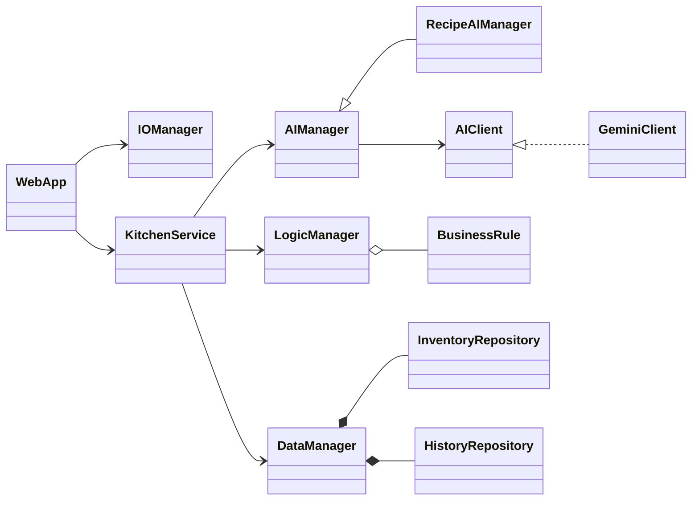

# Fridge Recipe Tracker (PROJECTKITCHEN)

[](https://github.com/clouden56/PROJECTKITCHEN/actions/workflows/ci.yml)

A web app that suggests recipes from what is already in your fridge and pantry, prioritising the food closest to
expiry. Built for **INF1103 Programming Fundamentals**, Team Project Phase 2 (object-oriented refactor and extension).

## The problem

Households throw away food that was forgotten until it expired, then spend more on groceries or takeaway, and face the
daily "what can I cook?" question. Fridge Recipe Tracker records each item with its expiry date and asks Google Gemini
for a recipe that uses the most urgent items first. The AI's answer is never trusted blindly: a set of business rules
checks every recipe for allergens, missing ingredients, must-have ingredients and cooking time before you see it.

## Features

| Feature | Where |
|---|---|
| Track fridge and pantry items with expiry badges; filter to items expiring within 3 days | **Inventory** page |
| Ask Gemini for a recipe (meal, time limit, allergies, must-include ingredients, cooking style) | **Suggest a recipe** |
| Every suggestion is routed to **ACCEPTED**, **FLAGGED** or **REJECTED**, with an expiry-priority score and grams of food saved | Recipe page |
| Search saved recipes by meal, ingredient or verdict | **History** |
| **New in Phase 2: recipe detail view.** Click any saved recipe to see it in full (ingredients, shopping list, equipment, numbered steps, waste impact), plus a re-check against **today's** inventory: can you still cook it, has the verdict changed, what has been used up since, and how every rule scored then vs now | **History → click a recipe** |
| **Advanced deliverable: web GUI** (Flask) replacing the Phase 1 terminal menu | Whole app |

### New feature: recipe detail and re-check

- **Problem it solves:** a saved recipe was just a line in a list, and its verdict went stale as the fridge changed.
- **How to use it:** on the History page or the dashboard, click a recipe. A newly generated recipe opens on this page automatically.
- **Classes involved:**
  - `KitchenService.compare_with_current()` re-runs the same `LogicManager` rules on the saved recipe with today's inventory.
  - `RecordComparison` works out what changed.
  - `WebApp.history_detail()` and `recipe_detail.html` display it.
  - Recipes saved in Phase 1 (before requests were stored) are re-checked with an inferred request.
- **Tests:** `RecordComparisonTests` in [tests/test_kitchen_service.py](tests/test_kitchen_service.py) and `RecipeDetailTests` in [tests/test_web_app.py](tests/test_web_app.py).

## Architecture

The four Phase 1 manager responsibilities are kept, each now a set of classes:

| Layer | File | Responsibility | Main classes |
|---|---|---|---|
| IO | [src/io_manager.py](src/io_manager.py), [src/web_app.py](src/web_app.py), `src/templates/` | Validate user input into typed objects; route HTTP; display results | `IOManager`, `Form`, `FormField` subclasses, `WebApp` |
| AI | [src/ai_manager.py](src/ai_manager.py) | `build_prompt` → `call_api` → `parse_response` → `validate_response` for **every** request; retries and model fallback | `AIClient` (interface), `GeminiClient`, `AIManager` (abstract), `RecipeAIManager` |
| Logic | [src/logic_manager.py](src/logic_manager.py) | Business rules on AI output: `evaluate`, `score`, `route` | `LogicManager`, `BusinessRule` → `RejectionRule`/`WarningRule` → five rules |
| Data | [src/data_manager.py](src/data_manager.py) | JSON persistence (`save`, `load`, `query`); survives missing/corrupt files | `Repository` (interface), `JsonRepository`, `DataManager`, `RecordFilter` |

Supporting modules:
- **[src/models.py](src/models.py):** the domain objects (`Ingredient`, `Inventory`, `Recipe`, `Evaluation`, `HistoryRecord`, and so on).
- **[src/kitchen_service.py](src/kitchen_service.py):** runs each use case through the managers in order.
- **[main.py](main.py):** `Application` builds everything once at start-up.

**UML class diagrams, OOP concept mapping and SOLID evidence:** [docs/uml/README.md](docs/uml/README.md)



## Quick start

### With Docker (recommended)

```bash
cp .env.example .env            # then put your GEMINI_API_KEY in .env
docker compose up --build app   # open http://localhost:5000
docker compose run --rm test    # run the test suite in the container (no API key needed)
```

`./data` is mounted into the container, so the inventory and history persist between runs.

### Without Docker

Requires Python 3.10 or newer.

```bash
pip install -r requirements.txt
python main.py                  # open http://127.0.0.1:5000
```

### Configuration

All settings come from environment variables or a git-ignored `.env` file; see [.env.example](.env.example).
**Never commit `.env` or an API key.**

| Variable | Default | Purpose |
|---|---|---|
| `GEMINI_API_KEY` | (none) | Required to generate recipes; get one from Google AI Studio |
| `SECRET_KEY` | random per start | Signs flash messages |
| `HOST` / `PORT` | `127.0.0.1` / `5000` | Where the web server listens (the Docker image uses `0.0.0.0`) |
| `DATA_DIR` | `data` | Folder for `inventory.json`, `recipe_history.json` and `app.log` |
| `GEMINI_MODELS` | `gemini-3.6-flash,gemini-flash-latest,gemini-2.5-flash-lite` | Model fallback order |

## Tests

```bash
python -m unittest discover -s tests -t . -v
```

The suite runs **without a live AI API**: [tests/sample_ai_responses.py](tests/sample_ai_responses.py) holds hardcoded
Gemini replies, and `StubAIClient` stands in for `GeminiClient` behind the `AIClient` interface.

| File | Covers |
|---|---|
| `test_logic_manager.py` | Every ACCEPTED / FLAGGED / REJECTED branch from sample AI replies, exact scores, rule order, adding a rule without editing `LogicManager` (OCP), every rule substitutable (LSP) |
| `test_ai_manager.py` | Prompt contents, schema validation of 9 malformed replies, retry/back-off, invalid key, model fallback, HTTP error mapping |
| `test_data_manager.py` | Save/load, corrupt-file quarantine, invalid rows, write failures, history filters |
| `test_io_manager.py` | Every form field's validation and display helpers |
| `test_kitchen_service.py` | The full pipeline, AI and storage failures, the recipe re-check feature |
| `test_web_app.py` | Every page end to end (Flask test client), including validation errors, AI outage, escaping, 404 and the detail page |
| `test_models.py` | Domain object validation, encapsulation and serialisation, including Phase 1 records |

## Continuous integration

[.github/workflows/ci.yml](.github/workflows/ci.yml) runs on every push and on every pull request into `main`:

1. **Lint and test** on Python 3.10 and 3.12: `ruff`, then the offline unittest suite.
2. **Docker:** builds the image, runs the tests inside it, then starts the web app and checks the pages respond.

Workflow: branch from `main` → small, descriptive commits → pull request → merge once CI is green.

## Project structure

```text
main.py                  Application: composition root, starts the web server
src/
  models.py              domain objects
  io_manager.py          form validation and display helpers
  web_app.py             Flask routes
  ai_manager.py          AI client interface, Gemini client, recipe AI manager
  logic_manager.py       business rules, scoring and routing
  data_manager.py        JSON repositories and history filters
  kitchen_service.py     use cases across the four managers
  config.py              settings from the environment / .env
  templates/, static/    HTML templates, CSS and JS
tests/                   unittest suites and sample AI responses
docs/uml/                UML class diagrams (Mermaid source, SVG, PNG)
docs/                    Phase 1 engineering report
scripts/                 submission packaging
```

## Submission packaging (Part 2)

The script below builds `dist/[LabGroup]_[TeamNumber]_ProjectPart2Final.zip` with the required folders. Before running it:
- Commit your work, because the code is exported from `HEAD`.
- Start Docker Desktop.
- Put the Part 2 report at `docs/Engineering_Report_Part2.pdf`.

```powershell
powershell -ExecutionPolicy Bypass -File scripts/package_submission.ps1 -LabGroup P1 -TeamNumber 07 -TeamAIdFile <path-to-TeamAId-export.csv>
```
