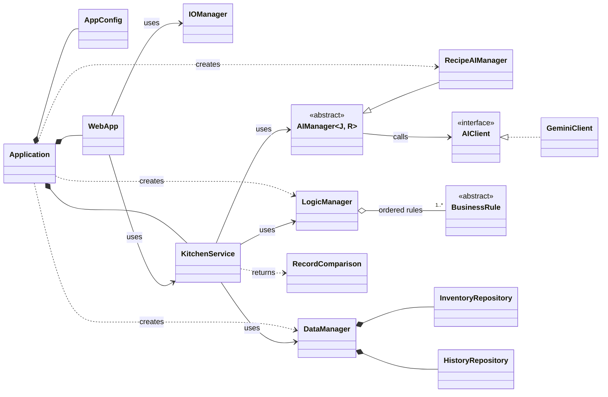
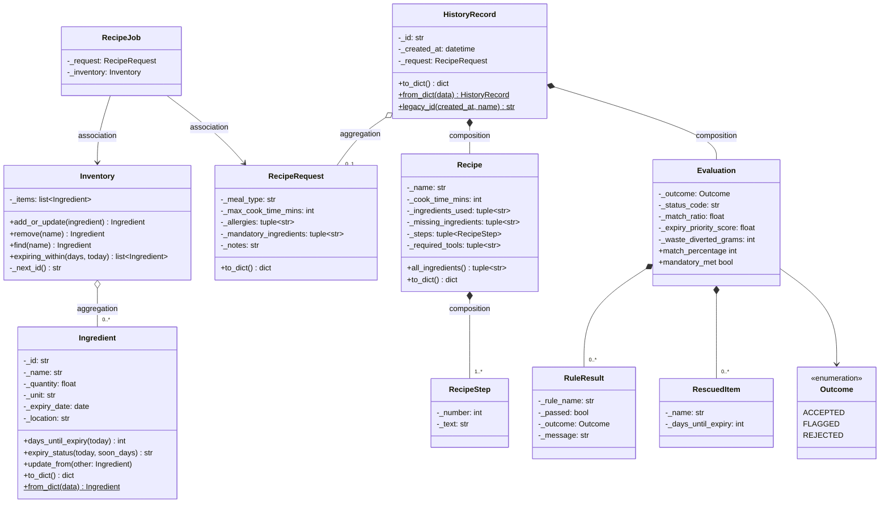
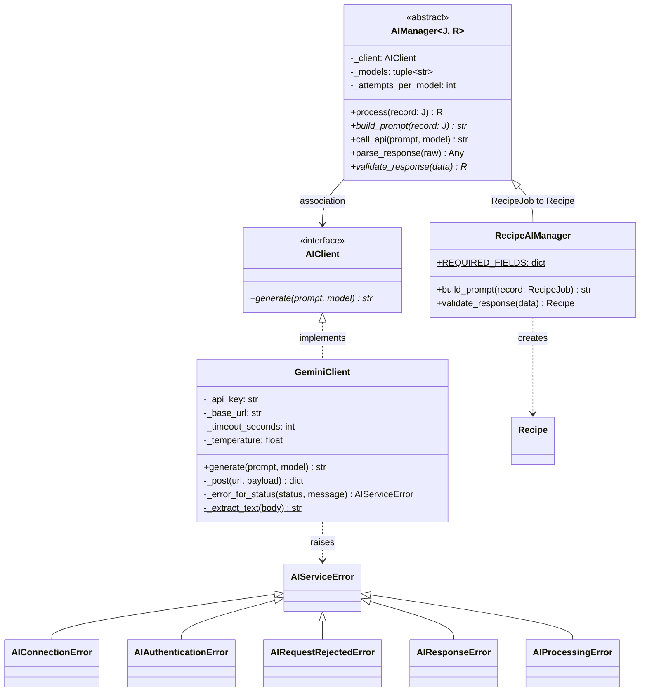
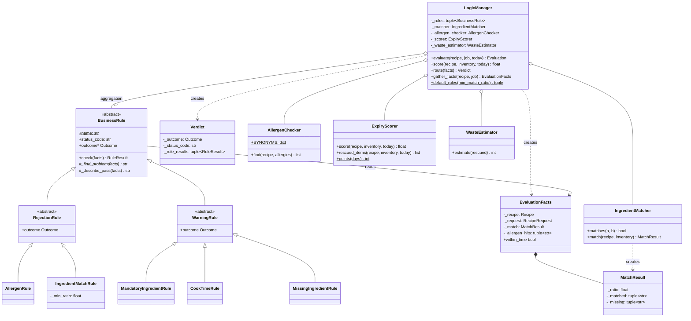
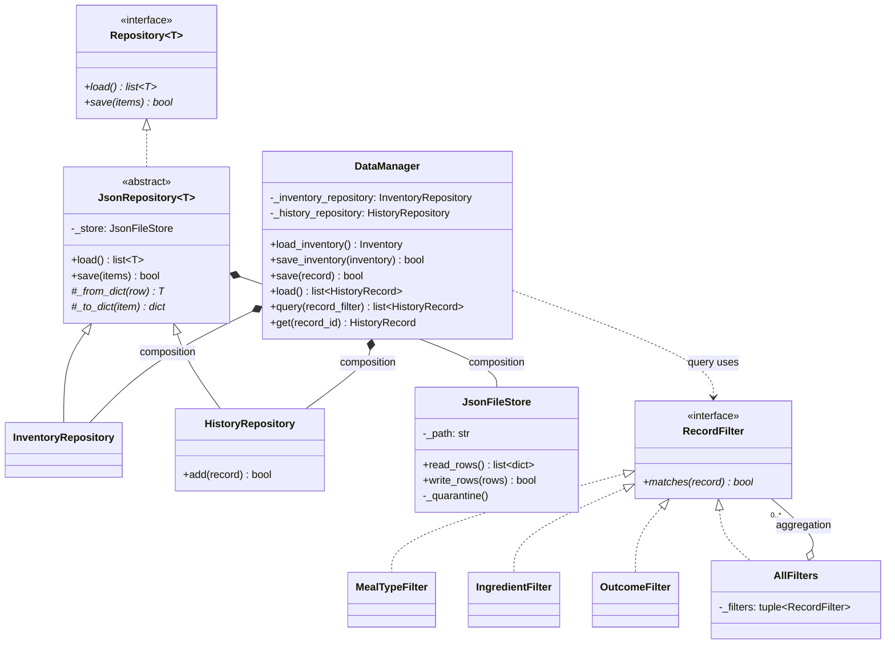
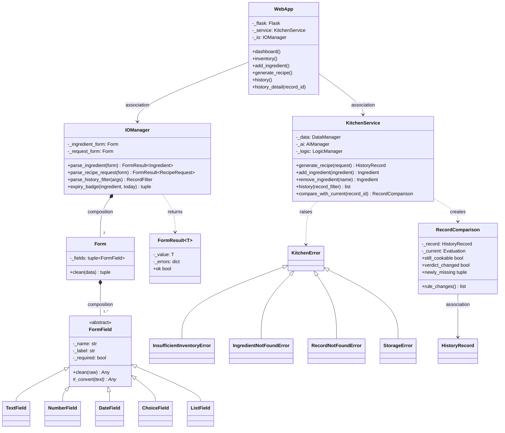

# UML class diagrams

Rendered images are in this folder (`*.svg`, `*.png`); GitHub also renders the Mermaid source below.

**Notation**
- **Stereotypes:** `<<interface>>` marks an ABC with only abstract methods; `<<abstract>>` marks an ABC that also shares behaviour.
- **Visibility:** `+` public, `-` private (a Python `_name` attribute), `#` protected (a `_method` that subclasses override).
- **Members:** `*` marks an abstract method; `$` marks a static method or class constant.

**Relationship arrows**

| Arrow | Relationship |
|---|---|
| `<\|--` | inheritance |
| `<\|..` | realisation of an interface |
| `*--` | composition (the owner creates the part and controls its lifecycle) |
| `o--` | aggregation (the whole holds parts that exist independently) |
| `-->` | association (uses or refers to, no ownership) |
| `..>` | dependency (creates or returns) |

## 1. Architecture overview

## 2. Domain model (`src/models.py`)

## 3. AI layer (`src/ai_manager.py`)

## 4. Logic layer (`src/logic_manager.py`)

## 5. Data layer (`src/data_manager.py`)

## 6. IO layer, web interface and application service

## Where each OOP concept is demonstrated

| Concept | Where | Why it fits the domain |
|---|---|---|
| Classes and objects | `Ingredient`, `Recipe`, `HistoryRecord`, `LogicManager`, `WebApp`, … created by `Application` | Every record and manager is a live object in the running web app |
| Encapsulation | All attributes are `_private` and exposed through read-only `@property`; `Ingredient` and `RecipeRequest` validate in the constructor | An invalid ingredient or request cannot exist, so no layer re-checks |
| Abstract classes | `AIManager`, `BusinessRule`, `JsonRepository`, `FormField` | Share behaviour (retry loop, `check()`, file I/O, blank handling) and leave one step abstract |
| Inheritance | `RejectionRule`/`WarningRule` → five rules; `JsonRepository` → `InventoryRepository`/`HistoryRepository`; `RecipeAIManager`; field types; exception hierarchies | Subclasses specialise one step only |
| Interfaces | `AIClient`, `Repository`, `RecordFilter` | Contracts with several implementations (`GeminiClient` and the test `StubAIClient`; filters) |
| Association | `KitchenService` → managers; `AIManager` → `AIClient`; `RecipeJob` → `Inventory`; `WebApp` → `IOManager` | Collaborators are injected and outlive each other |
| Aggregation | `Inventory` ◇ `Ingredient`; `LogicManager` ◇ `BusinessRule`; `AllFilters` ◇ `RecordFilter` | Parts exist on their own (a removed ingredient still exists; rules are configured outside) |
| Composition | `Recipe` ◆ `RecipeStep`; `DataManager` ◆ repositories; `JsonRepository` ◆ `JsonFileStore`; `Form` ◆ `FormField`; `HistoryRecord` ◆ `Recipe`/`Evaluation` | The owner creates the part and the part has no life outside it |
| Polymorphism | `LogicManager.route()` calls `rule.check()` on every rule; `AIManager` calls `client.generate()`; `DataManager.query()` calls `filter.matches()` | No `isinstance` branching; new rules, clients or filters plug in unchanged |

## SOLID evidence

| Principle | Evidence |
|---|---|
| **S**ingle responsibility | `JsonFileStore` only does safe file I/O; `IngredientMatcher`, `AllergenChecker`, `ExpiryScorer` and `WasteEstimator` each own one calculation; `WebApp` only routes HTTP; `IOManager` only validates and formats |
| **O**pen/closed | A new rule (`BusinessRule` subclass), AI provider (`AIClient`), filter (`RecordFilter`) or field type (`FormField`) is added without editing `LogicManager`, `AIManager`, `DataManager` or `Form`. This is shown by `test_new_rule_plugs_in_without_changing_logic_manager` |
| **L**iskov substitution | Every rule is usable wherever a `BusinessRule` is expected and returns a `RuleResult` with its declared outcome (`test_every_rule_is_substitutable_for_business_rule`); `StubAIClient` replaces `GeminiClient` in all tests |
| **D**ependency inversion | `KitchenService` depends on the abstract `AIManager`/`AIClient`; `Application` wires the concrete classes in one place |
